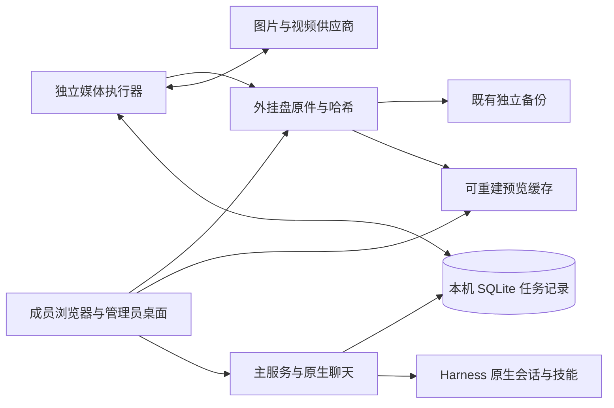

# 架构优化与验收边界

本轮以既定成员聊天流程为基础，改善执行、恢复和运维。没有新增审批步骤，没有新增页面或侧栏，没有更改模型开关范围。

| 项目 | 候选实现 | 上线前验收 |
| --- | --- | --- |
| 独立媒体执行 | API 与媒体任务分进程；同根分别持锁；进程身份与代码摘要匹配；任务执行领取持久化 | API 意外关闭、重连、执行器异常退出、未知提交不重发 |
| 调度与资源 | 进行中状态及计划索引；近 24 小时交付时间索引；独立上传、下载、检查、预览队列 | 多成员并发、超出可用执行槽排队；全历史不进入每次调度扫描 |
| 交付监控 | 供应商提交、生成、下载、检查、可下载分别记录；设置内显示交付计数和延迟 | 下载未结束/技术检查未通过不能显示可交付；失败保留原因 |
| 画廊预览 | 按原件哈希生成缓存；大图及大视频使用轻量预览；原件下载不变 | 私有媒体访问、Range、缓存复用、原件 SHA256；浏览器播放仍需可视核验 |
| 原生兼容 | 固定 0.2.0-rc.2；升级契约检查已安装的六个原生客户端包 | 工作区、工具轨迹、附件画廊、文件下载、品牌、设置导航；契约通过不替代浏览器验收 |
| 生产记录 | 现有任务追踪关联剧本片段、意见、技能、模型版本、实际提示词、参考资产哈希和成品 | 后续补抽保留上一轮链路；不另建业务表单；计费保持管理员后台 |
| 存储恢复 | 主机文件编辑前保存哈希版本；聊天工具 history/restore 恢复并保留被覆盖版本；已有外盘监控与备份演练复用 | 并发保存冲突、版本损坏、原件校验；正式外盘与独立备份另做目标机测试 |
| 多机职责与连接 | 只读机器身份检查，区分本机、wawuwawu 主机、host-b 独立主机；比较 serverId 与卷 UUID | 局域网及 Tailscale 分别采样；外网长连接测试通过后才能称稳定 |

## 同一台主机内的关系

每台独立主机各有自己的这一套记录。图中的数据库与外盘属于同一台主机，不通过网络共享写入。

## 任务语义

一次明确授权生成对应一份持久任务。API 重连或执行器重启继续原任务。网络中断导致供应商收单不明时保留 `submission_unknown`，不自动重发创建请求；成员已授权的换型、修改、新任务继续可提交，十分钟后的再次提交仍须来自成员本次明确请求。后台只对可确认未发送的提交准备失败安全重试；已收到回执的下载失败重试原结果。

执行权记录只用于防止不同进程同时处理同一任务，不改变成员权限。它同时阻止尚在执行时管理员误把任务当作停止任务核对。崩溃残留记录以锁的进程身份判定失效。

## 运维顺序

1. 核对目标 `serverId`、卷 UUID、代码清单及已有任务。两台 mini 使用各自数据库，不能把 SQLite 文件相互覆盖；源码同步也不代表聊天实时同步。
2. 在外盘完整备份当前应用与数据。现有离线备份入口继续使用；API 和媒体执行器、原生容器都停止后才允许离线快照。即使 API 已退出，只要执行器还运行，离线备份会明确拒绝。
3. 在独立数据根测试候选，再替换源码和已构建客户端。已运行的旧执行器摘要不匹配时保留旧进程并报告冲突，不能偷偷启动第二个。
4. 健康检查包含主服务、媒体执行器心跳、任务交付、外盘和备份。版本回退先完整停止候选所有写入者，再恢复成套备份；不单独换旧二进制后继续写入新状态。
5. 密钥只保留在主机既有存储，诊断报告不输出密钥、Cookie 或供应商签名原片 URL。

`check-machines.py` 只执行已有严格 SSH 身份验证、主机名读取、回环服务状态读取和卷信息读取。它不修改 Tailscale、代理、全局 SSH、账户或自启。短采样可达不等于稳定；外网稳定需要持续 SSH/VNC 数据流及切网恢复实测。

## 核实依据

- [Harness 官方架构](https://github.com/deepseek-ai/deepseek-harness/blob/master/docs/architecture.md)：保留原生会话、工具和插件服务。
- [SQLite WAL](https://sqlite.org/wal.html)：同主机数据库、多读者、串行写事务，不采用跨机器共享数据库。
- [BullMQ 幂等任务说明](https://docs.bullmq.io/patterns/idempotent-jobs)：参考任务恢复原则，本项目未引入 Redis/BullMQ。
- [AWS 安全重试设计](https://aws.amazon.com/builders-library/making-retries-safe-with-idempotent-APIs/)：请求身份、未知收单、重试边界。
- [Tailscale 连接类型](https://tailscale.com/docs/reference/connection-types)：区分直连、中继和实际链路验证。

资料用于架构选择，不代替当前代码测试或正式主机验收。
